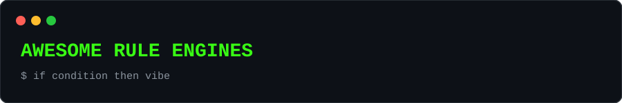

  

> A curated list of rule engines, business rules management systems, rule languages, and the libraries and reading material that surround them.

This list covers the whole rule-engine landscape: the classic AI-lineage engines (Rete-based forward chaining, Prolog-family backward chaining), the enterprise BRMS platforms built on top of them, the standalone rule languages and interchange formats that outlive any one engine, the lightweight libraries teams actually reach for in a given language, and the books and papers the field is built on. Each entry is a real, current project or resource — verify license, maintenance status, and version compatibility against the upstream docs before adopting.

**How this is organized:**

- Sections 1–2 group engines by **reasoning direction** — forward-chaining (Rete-style, data-driven: facts push through a network of rules) versus backward-chaining (goal-driven, Prolog-family: start from a query and work backward to the facts that satisfy it) — because that split determines how an engine actually executes, independent of the language it's written in.
- Section 3 covers full **Business Rules Management Systems**: authoring UIs, decision tables, governance, and audit trails, as a distinct product category from a bare engine library.
- Section 4 covers **rule languages and interchange formats** that aren't tied to any single engine.
- Section 5 covers **lightweight, ecosystem-idiomatic rule libraries**, organized by language, for teams who want the pragmatic option for their stack rather than a dedicated Rete or Prolog engine.
- Section 6 is the **reading list** for the theory underneath all of it.

### `$ whoami`

Pick a lane — jump straight to the sections that matter for your role.

| Role | Start here |
| --- | --- |
| 🏗️ Enterprise Architect | [Business Rules Management Systems](#business-rules-management-systems-brms) · [Rule Languages & DSLs](#rule-languages--dsls) for standards-based interchange |
| 👨‍💻 Backend Developer | [Language-Specific Libraries](#language-specific-libraries) for your stack · [Forward-Chaining Engines](#forward-chaining-engines) for pattern-matching workloads |
| 📋 Compliance Engineer | [Business Rules Management Systems](#business-rules-management-systems-brms) for audit trails and decision tables · [DMN](#rule-languages--dsls) and [SBVR](#rule-languages--dsls) for governance |
| 🧠 AI / Expert-Systems Researcher | [Backward-Chaining Engines](#backward-chaining-engines) · [Forward-Chaining Engines](#forward-chaining-engines) · [Learning Resources](#learning-resources) |

### `$ ls ./sections`

- [Forward-Chaining Engines](#forward-chaining-engines)
- [Backward-Chaining Engines](#backward-chaining-engines)
- [Business Rules Management Systems (BRMS)](#business-rules-management-systems-brms)
- [Rule Languages & DSLs](#rule-languages--dsls)
- [Language-Specific Libraries](#language-specific-libraries)
  - [Java / JVM](#java--jvm)
  - [Python](#python)
  - [JavaScript / TypeScript](#javascript--typescript)
  - [Go](#go)
  - [Rust](#rust)
  - [.NET](#net)
- [Learning Resources](#learning-resources)
- [Related Awesome Lists](#related-awesome-lists)
- [Contributing](#contributing)
- [License](#license)

## Forward-Chaining Engines

Rete-algorithm-based and other forward-chaining engines: facts flow in, matching rules fire, and their actions can assert new facts that trigger further rules.

- [Clara Rules](https://github.com/oracle-samples/clara-rules) — Rete-based forward-chaining rules engine for Clojure and ClojureScript.
- [CLIPS](https://sourceforge.net/projects/clipsrules/) — C Language Integrated Production System, a long-standing forward-chaining expert system shell and one of the original Rete-based tools.
- [Drools](https://github.com/apache/incubator-kie-drools) — Java rule engine built on the PHREAK (Rete-derived) algorithm, developed under the Apache KIE project.
- [Durable Rules](https://github.com/jruizgit/rules) — Polyglot forward-chaining rules engine with bindings for Python, Node.js, and Ruby, built for event correlation at scale.
- [Experta](https://github.com/nilp0inter/experta) — CLIPS-inspired, Rete-based expert system library for Python, forked from PyKnow.
- [NRules](https://github.com/NRules/NRules) — .NET rules engine based on the Rete matching algorithm, with an internal DSL in C#.

## Backward-Chaining Engines

Goal-driven / backward-chaining engines and Prolog-family systems: reasoning starts from a query and works backward through rules to the facts that would satisfy it.

- [Ciao Prolog](https://github.com/ciao-lang/ciao) — Modular Prolog implementation designed to be portable, extensible, and suited to both teaching and production use.
- [core.logic](https://github.com/clojure/core.logic) — miniKanren-derived logic programming library for Clojure and ClojureScript, used for goal-driven relational reasoning.
- [ECLiPSe](https://eclipseclp.org) — Open-source constraint logic programming system extending Prolog-style resolution with constraint solvers, used for planning and scheduling.
- [GNU Prolog](https://github.com/didoudiaz/gprolog) — Free Prolog compiler with native-code generation and built-in finite-domain constraint solving.
- [Scryer Prolog](https://github.com/mthom/scryer-prolog) — Modern, actively developed ISO-conformant Prolog implementation written mostly in Rust.
- [SWI-Prolog](https://github.com/SWI-Prolog/swipl-devel) — Widely used, actively maintained Prolog environment with extensive libraries for constraints, the web, and semantic-web reasoning.
- [tau-prolog](https://github.com/tau-prolog/tau-prolog) — Prolog interpreter implemented in JavaScript for running logic-programming rules directly in the browser or Node.js.
- [tuProlog / 2p-kt](https://github.com/tuProlog/2p-kt) — Kotlin Multiplatform ecosystem for symbolic AI, continuing the tuProlog lightweight, modular Prolog engine.
- [XSB](https://xsb.sourceforge.net) — Tabled Prolog and deductive database system that extends SLD resolution with memoization to support recursive queries.

## Business Rules Management Systems (BRMS)

Full BRMS platforms with authoring UIs, decision tables, versioning, and governance on top of a rule engine.

- [Apache KIE Tools](https://github.com/apache/incubator-kie-tools) — Authoring tooling for the Apache KIE business-automation stack, including the DMN and BPMN editors used in KIE Sandbox and Business Central.
- [DecisionRules](https://www.decisionrules.io) — Commercial decision automation platform with decision tables, decision trees, scripting rules, lookup tables and decision flows, a test bench with regression test suites, a REST API and an MCP server, available as SaaS or self-hosted.
- [FICO Blaze Advisor](https://www.fico.com/en/products/fico-blaze-advisor) — Commercial business rules management system widely used in financial-services decisioning; included as a long-standing industry-standard BRMS.
- [GoRules (Zen Engine)](https://github.com/gorules/zen) — Open-source business rules engine written in Rust, with Node.js, Python, and Go bindings, built around a JSON Decision Model (JDM) format and a companion open-source visual editor.
- [IBM Operational Decision Manager (ODM)](https://www.ibm.com/products/operational-decision-manager) — Commercial BRMS combining a rule engine, decision-table authoring, and event processing; a long-established enterprise decisioning platform.
- [InRule](https://www.inrule.com) — Commercial decision-automation platform combining a business rules engine, visual rule authoring, and machine-learning integration.
- [OpenL Tablets](https://github.com/openl-tablets/openl-tablets) — Open-source, Java-based BRMS that lets business users define decision logic in Excel-based decision tables.
- [Progress Corticon](https://www.progress.com/corticon) — Commercial BRMS focused on visual, no-code rule modeling with audit trails for regulated industries such as insurance and healthcare.

## Rule Languages & DSLs

Standalone rule languages, notations, and interchange formats that aren't tied to one engine.

- [CQL (Clinical Quality Language)](https://cql.hl7.org) — HL7 standard domain-specific language for expressing clinical quality measures and decision-support logic.
- [DMN (Decision Model and Notation)](https://www.omg.org/spec/DMN/) — OMG standard notation and expression language for modeling and executing business decisions independent of any single engine.
- [Jena Rules](https://jena.apache.org/documentation/inference/) — Rule language and reasoner subsystem in Apache Jena supporting forward chaining, backward chaining, and hybrid execution over RDF data.
- [JsonLogic](https://jsonlogic.com) — Language-agnostic format for expressing rules as JSON so the same logic can run unchanged on a server and in a browser.
- [N3Logic (Notation3)](https://www.w3.org/TeamSubmission/n3/) — Rule-capable extension of the Notation3 RDF syntax, supporting logical implication over semantic-web data.
- [PRR (Production Rule Representation)](https://www.omg.org/spec/PRR/) — OMG metamodel for representing production rules independently of any specific rule engine vendor.
- [RIF (Rule Interchange Format)](https://www.w3.org/TR/rif-overview/) — W3C family of standards for exchanging rules between different rule systems and rule engines on the Web.
- [RuleML](https://ruleml.org) — XML-based markup language initiative for representing and exchanging business rules, Datalog, and derivation rules.
- [SBVR (Semantics of Business Vocabulary and Business Rules)](https://www.omg.org/spec/SBVR/) — OMG standard for capturing business vocabulary and rules in a form that can be exchanged between organizations and tools.
- [SWRL (Semantic Web Rule Language)](https://www.w3.org/Submission/SWRL/) — W3C submission combining OWL ontologies with Horn-like rules for semantic-web reasoning.

## Language-Specific Libraries

Lighter-weight rule and decision libraries, organized by ecosystem, for teams that want the idiomatic option for their stack rather than a dedicated Rete or Prolog engine.

### Java / JVM

- [Easy Rules](https://github.com/j-easy/easy-rules) — Lightweight, POJO-based rules engine for Java with a simple condition-action API.
- [MVEL](https://github.com/mvel/mvel) — Expression language and runtime for the JVM commonly used to write rule conditions and actions inside Java rule engines.

### Python

- [business-rules](https://github.com/venmo/business-rules) — Python DSL that lets non-programmers configure condition-action business logic without writing code.
- [rule-engine](https://github.com/zeroSteiner/rule-engine) — Lightweight, optionally typed expression language and engine for matching arbitrary Python objects against rules.

### JavaScript / TypeScript

- [json-rules-engine](https://github.com/CacheControl/json-rules-engine) — Rules engine expressed entirely in JSON, built for Node.js and browser use.
- [node-rules](https://github.com/mithunsatheesh/node-rules) — Lightweight forward-chaining rules engine for JavaScript and TypeScript projects.

### Go

- [Grule](https://github.com/hyperjumptech/grule-rule-engine) — Rule engine for Go with its own Grule Rule Language (GRL) for defining rules.

### Rust

- [Nemo](https://github.com/knowsys/nemo) — Fast, in-memory Datalog-based rule engine for reasoning over large rule sets, developed by the KnowSys research group.

### .NET

- [Microsoft RulesEngine](https://github.com/microsoft/RulesEngine) — .NET rules engine that evaluates rules defined as JSON with dynamic C# expression support.

## Learning Resources

Books, papers, and articles on rule-based systems, expert systems, and the business-rules discipline.

- *Building Expert Systems* — Frederick Hayes-Roth, Donald Waterman & Douglas Lenat, Addison-Wesley, 1983.
- *Business Rules Applied* — Barbara von Halle, Wiley, 2001.
- [Business Rules Manifesto](http://www.businessrulesgroup.org/brmanifesto.htm) — Business Rules Group, 2003.
- *Decision Management Systems* — James Taylor, IBM Press, 2011.
- *Expert Systems: Principles and Programming* — Joseph Giarratano & Gary Riley, Course Technology, 2004 (4th ed.).
- *Programming Expert Systems in OPS5* — Lee Brownston, Robert Farrell, Elaine Kant & Nancy Martin, Addison-Wesley, 1985.
- *Prolog Programming for Artificial Intelligence* — Ivan Bratko, Addison-Wesley, 2011 (4th ed.).
- [Rete: A Fast Algorithm for the Many Pattern/Many Object Pattern Match Problem](https://doi.org/10.1016/0004-3702(82)90020-0) — Charles Forgy, *Artificial Intelligence*, 1982.
- [Rules Engine](https://martinfowler.com/bliki/RulesEngine.html) — Martin Fowler, 2009.

## Related Awesome Lists

- [awesome-artificial-intelligence](https://github.com/owainlewis/awesome-artificial-intelligence) — AI courses, books, video lectures, and papers, including symbolic and knowledge-based reasoning.
- [awesome-datalog](https://github.com/samuell/awesome-datalog) — Datalog libraries, tools, and resources.
- [awesome-knowledge-graph](https://github.com/totogo/awesome-knowledge-graph) — Knowledge-graph tools and resources, adjacent to semantic-web rule reasoning.
- [awesome-lisp-languages](https://github.com/dundalek/awesome-lisp-languages) — Lisp-flavored languages, the family that produced OPS5 and much of the original expert-systems tooling.
- [awesome-production-machine-learning](https://github.com/EthicalML/awesome-production-machine-learning) — Includes decision-management and MLOps tooling adjacent to rule engines.
- [awesome-prolog](https://github.com/klaudiosinani/awesome-prolog) — Curated list of Prolog packages and resources.
- [awesome-semantic-web](https://github.com/semantalytics/awesome-semantic-web) — Semantic-web tools, including rule and reasoning languages like SWRL and RIF.

## Contributing

Contributions are welcome. Open a pull request that:

1. Adds a project only if it is **actively maintained** (commit or release within the last 18 months) or is a recognized, still-functional, canonical implementation.
2. Places the entry in the most specific existing section, alphabetized within that section.
3. Uses the format: `- [Project name](url) — Short, neutral description ending in a period.`
4. Avoids marketing language, superlatives, or unverified claims.
5. Prefers OSS projects; commercial tools are accepted only when they have no comparable OSS equivalent or are de-facto industry standards.

## License

This work is licensed under the [MIT License](LICENSE.md).
